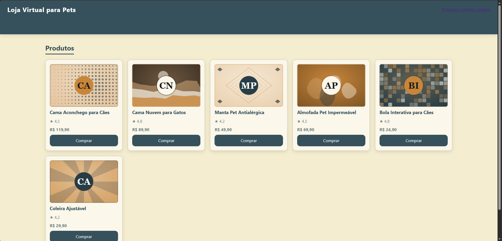

# MultiAgentAI — gerador de sites com agentes de IA

Aplicação em Python que transforma **um texto (prompt)** em um **site completo e funcionando**
(Flask + SQLite + HTML/CSS/JS). Vários agentes de IA rodando localmente no **Ollama** (modelo
`llama3.2`) dividem o trabalho, e um conjunto de verificações automáticas confere e conserta o
resultado, já que modelos pequenos erram com frequência.

Você digita o pedido em uma janela de chat e, no final, recebe uma pasta com o site pronto para abrir no navegador.

---

## Exemplo: loja PATA & CIA

Prompt enviado ao chat e o site que o sistema gerou, com banco de dados, API e imagens.



<details>
<summary><b>Ver o prompt completo usado neste exemplo</b></summary>

# PATA & CIA — Loja Virtual para Pets

## Apresentação

Crie uma loja virtual completa, moderna, minimalista e responsiva chamada **PATA & CIA**, especializada em acessórios, brinquedos, camas, higiene e produtos para cães e gatos.

O site deve transmitir carinho, diversão e confiança, com uma identidade visual contemporânea e acolhedora. Utilize fotografias realistas de animais de estimação, tipografia moderna, bastante espaço em branco, cards elegantes e animações discretas.

A navegação deve ser simples e intuitiva, com adaptação perfeita para computadores, tablets e celulares. O design deve equilibrar uma aparência divertida com uma apresentação profissional de e-commerce.

## 1. Paleta de cores

Utilize uma paleta clara e diferente das anteriores:

- **Azul piscina pastel — `#D8EEF1`:** fundos de destaque e seções especiais.
- **Amarelo-creme — `#F5EDCF`:** etiquetas, promoções e detalhes.
- **Coral suave — `#F3D8D0`:** elementos decorativos e pequenos destaques.
- **Verde-água claro — `#DCEBE1`:** fundos secundários e cards.
- **Branco algodão — `#FCFCF9`:** fundo principal.
- **Cinza quente — `#B9B9B1`:** bordas e divisórias.
- **Azul profundo — `#36515C`:** títulos, textos principais e botões.

Mantenha o fundo predominantemente claro, com cantos levemente arredondados, sombras suaves e bastante espaço entre os elementos. Utilize as cores pastel de forma equilibrada, sem deixar a interface visualmente carregada.

## 2. Cabeçalho

Crie um cabeçalho minimalista com fundo branco algodão e uma divisória discreta na parte inferior.

À esquerda, posicione o logotipo textual **PATA & CIA**, acompanhado de um pequeno símbolo de patinha estilizada.

No centro, inclua o menu de navegação:

- Início
- Cachorros
- Gatos
- Brinquedos
- Camas e Conforto
- Higiene

À direita, adicione os ícones de pesquisa, conta do usuário, favoritos e carrinho de compras. O carrinho deve mostrar um indicador com a quantidade de produtos adicionados.

O cabeçalho deve ser responsivo, utilizando um menu compacto em dispositivos móveis. Os links devem ter transições suaves ao passar o mouse, preservando a aparência limpa e organizada.

## 3. Página inicial

Crie uma seção principal de destaque (*hero section*) dividida em duas áreas: texto à esquerda e uma fotografia ampla à direita.

A imagem deve mostrar um cachorro e um gato em um ambiente doméstico aconchegante, cercados por brinquedos, almofadas e acessórios para pets. Utilize iluminação natural, cores suaves e uma composição moderna.

**Título principal:**

"MAIS CARINHO EM CADA PATINHA."

**Subtítulo:**

"Tudo para deixar a rotina do seu melhor amigo mais confortável, divertida e cheia de momentos especiais."

Inclua dois botões:

- **Explorar produtos:** direciona para o catálogo.
- **Encontrar favoritos:** direciona para os produtos em destaque.

Abaixo do destaque, apresente três diferenciais com ícones minimalistas:

- Conforto para todos os momentos.
- Diversão para cães e gatos.
- Acessórios para uma rotina mais prática.

Em seguida, crie uma seção de categorias com cards visuais para Cachorros, Gatos, Brinquedos e Conforto. Cada card deve conter uma imagem representativa, um título e um link para explorar os produtos correspondentes.

Adicione uma seção chamada **"Os queridinhos dos pets"**, exibindo alguns produtos em destaque com imagens, nomes, preços, avaliações e botões para favoritar ou adicionar ao carrinho.

## 4. Catálogo de produtos

Crie um catálogo com exatamente **20 produtos**, divididos em quatro categorias.

### Camas e conforto

1. **Cama Aconchego para Cães** — Cama macia com laterais acolchoadas para momentos de descanso. **R$ 119,90**

2. **Cama Nuvem para Gatos** — Cama compacta e confortável para gatos descansarem. **R$ 89,90**

3. **Manta Pet Antialérgica** — Manta macia para proteger sofás, camas e caminhas. **R$ 49,90**

4. **Almofada Pet Impermeável** — Almofada prática com superfície resistente à umidade. **R$ 69,90**

5. **Toca para Gatos** — Abrigo aconchegante para gatos que gostam de espaços protegidos. **R$ 99,90**

### Brinquedos e diversão

6. **Bola Interativa para Cães** — Brinquedo para estimular a atividade e a brincadeira. **R$ 24,90**

7. **Corda de Brincar** — Brinquedo resistente para brincadeiras supervisionadas com cães. **R$ 19,90**

8. **Varinha com Penas para Gatos** — Brinquedo para estimular a curiosidade e os movimentos dos gatos. **R$ 17,90**

9. **Túnel Dobrável para Gatos** — Túnel leve para brincadeiras e exploração dentro de casa. **R$ 59,90**

10. **Brinquedo Recheável para Cães** — Brinquedo que pode ser preenchido com petiscos apropriados. **R$ 34,90**

### Passeio e acessórios

11. **Coleira Ajustável** — Coleira confortável com regulagem para diferentes tamanhos. **R$ 29,90**

12. **Guia para Passeio** — Guia prática para acompanhar os passeios diários. **R$ 39,90**

13. **Peitoral Anatômico** — Peitoral ajustável para maior conforto durante os passeios. **R$ 59,90**

14. **Bolsa de Transporte para Pets** — Bolsa ventilada para transportar animais de pequeno porte, respeitando os limites de peso do fabricante. **R$ 149,90**

15. **Bebedouro Portátil** — Recipiente compacto para oferecer água durante passeios. **R$ 34,90**

### Higiene e organização

16. **Kit de Escovas para Pets** — Conjunto de escovas para auxiliar na manutenção da pelagem. **R$ 39,90**

17. **Tapete Higiênico Lavável** — Tapete reutilizável para auxiliar na rotina de higiene dos cães. **R$ 49,90**

18. **Caixa de Areia para Gatos** — Caixa prática para organizar o espaço de higiene dos felinos. **R$ 79,90**

19. **Pá para Areia de Gato** — Acessório para facilitar a limpeza diária da caixa de areia. **R$ 12,90**

20. **Organizador de Acessórios Pet** — Caixa com compartimentos para guardar brinquedos, guias e acessórios. **R$ 44,90**

Apresente os produtos em uma grade responsiva, com quatro colunas em telas grandes e adaptação automática para tablets e celulares.

Cada card deve conter imagem, nome, descrição curta, preço em reais, avaliação por estrelas, botão de favoritar e botão de adicionar ao carrinho.

Implemente pesquisa por nome, filtros por categoria e faixa de preço, além de ordenação por menor preço, maior preço e nome.

O carrinho deve permitir adicionar e remover produtos, alterar quantidades e calcular automaticamente o subtotal. Exiba uma mensagem discreta de confirmação quando um produto for adicionado.

Utilize imagens variadas e coerentes com cada produto, mostrando cães, gatos e acessórios de acordo com o item. Garanta que todos os 20 produtos estejam disponíveis no catálogo e que seus preços correspondam exatamente aos apresentados.

O resultado final deve transmitir a identidade de uma marca pet moderna, acolhedora, confiável e funcional, mantendo a mesma linguagem visual em todas as telas.

</details>

> Prompts detalhados (paleta em hexadecimal, seções, produtos e botões) dão resultados melhores.

---

## Como funciona

```
Prompt do usuário
      │
      ▼
 Arquiteto ──► Banco de dados ──► Front-end ──► Designer ──► Back-end ──► Revisor
 (plano)       (schema.sql)       (HTML/JS)     (CSS)        (Flask)      (relatório)
                                                                              │
                                                                              ▼
                                                           Verificador + Ilustrador
                                                    (testa o site, conserta e cria imagens)
```

| Etapa | O que faz |
|---|---|
| **Arquiteto** | Lê o pedido e define páginas, tabelas e rotas. |
| **Banco de dados** | Escreve o `schema.sql` (tabelas e dados de exemplo). |
| **Front-end** | Gera `index.html` e `script.js`, que busca os dados na API. |
| **Designer** | Reescreve o `style.css` com o visual e a paleta pedidos. |
| **Back-end** | Gera o `backend.py` (Flask + SQLite) com as rotas `/api/...`. |
| **Revisor** | Escreve um relatório (`docs/revisao.txt`). |
| **Verificador** | Sobe o site numa cópia, chama as rotas e confere HTML e JavaScript. Quando acha erro, conserta sozinho. |
| **Ilustrador** | Cria imagens SVG genéricas na paleta do site, para os cards não ficarem vazios. |

### Rede de segurança (por que o resultado funciona)

Como o `llama3.2` é um modelo pequeno, o `orchestrator.py` não confia cegamente na resposta dele:

- Se o **backend** gerado falhar na validação, ele é refeito; se continuar errado, usa um backend de reserva montado a partir do `schema.sql`.
- Se o **JavaScript** usar campos que a API não devolve, tiver PHP no HTML ou botões sem ação, o `verificador.py` refaz o `script.js` a partir da API.
- Se o **CSS** perder as cores do pedido ou vier quebrado, as variáveis são restauradas; em último caso, um CSS de reserva é gerado com a paleta do prompt.
- Dados de exemplo e imagens são criados quando faltam.

---

## Estrutura do repositório

```
ProjetoPy/
├── MultiAgentAI/
│   ├── agents/              # um arquivo por agente (architect, database, frontend, designer, backend, reviewer)
│   ├── orchestrator.py      # coordena os agentes e aplica as correções automáticas
│   ├── verificador.py       # testa e conserta o site gerado
│   ├── ilustrador.py        # cria as imagens genéricas (SVG)
│   ├── chat_app.py          # janela de chat (Tkinter)
│   ├── main.py
│   ├── memory/
│   └── generated_projects/  # sites gerados (cada execução cria uma pasta nova)
├── Evolucao_projetos/       # histórico dos sites de teste, do primeiro ao último
├── iniciar.bat              # abre o chat no Windows
├── requirements.txt
├── pyproject.toml / uv.lock
└── README.md
```

---

## Evolução dos projetos (`Evolucao_projetos/`)

A pasta [`Evolucao_projetos/`](Evolucao_projetos/) guarda os sites gerados durante o desenvolvimento, do primeiro teste até a versão final. Cada subpasta é um projeto completo, que roda sozinho, e mostra o que o sistema produzia naquela fase e que problema foi corrigido depois.

Para rodar qualquer um:

```bash
cd Evolucao_projetos/<pasta-do-projeto>
pip install flask
python backend.py
```

Abra **http://127.0.0.1:5000**. O `database.db` é criado na primeira execução. A pasta `docs/` de cada projeto traz o pedido original e o `style_original.css`, para comparar o CSS antes e depois do designer.

---

## Requisitos

- **Windows** (o `iniciar.bat` foi feito para ele; no Linux/macOS basta rodar o comando Python à mão)
- **Python 3.10 ou superior** (com Tkinter, que já vem no instalador oficial)
- **[Ollama](https://ollama.com/download)** instalado e em execução
- Modelo baixado: `ollama pull llama3.2`
- Uma máquina com memória suficiente para rodar o `llama3.2` (gerar um site leva alguns minutos)

---

## Como rodar

1. **Clone o repositório**
   ```bash
   git clone <https://github.com/Luccascocenco/MultiAgentAI>
   cd ProjetoPy
   ```

2. **Crie o ambiente virtual e instale as bibliotecas**
   ```bash
   python -m venv .venv
   .venv\Scripts\activate
   pip install -r requirements.txt
   ```
   Se preferir o `uv`: `uv sync`.

3. **Deixe o Ollama rodando e baixe o modelo**
   ```bash
   ollama pull llama3.2
   ```

4. **Abra o chat**
   - Dê duplo clique em `iniciar.bat`, ou
   - rode `.venv\Scripts\python.exe MultiAgentAI\chat_app.py`

5. **Digite o pedido do site** e envie. O log mostra cada etapa (`>>> database`, `>>> frontend`, `>>> designer`, `>>> teste`...). Dica: quanto mais detalhado o prompt (paleta com códigos hexadecimais, seções, produtos, botões), melhor o resultado — veja [`exemplos/prompt-pata-e-cia.md`](exemplos/prompt-pata-e-cia.md).

6. **Abra o site gerado.** Ao terminar, o projeto fica em `generated_projects/<nome>_<data-hora>/`:
   ```bash
   cd generated_projects/<pasta-do-projeto>
   pip install flask        # se ainda não instalou
   python backend.py
   ```
   Acesse **http://127.0.0.1:5000**. Para usar outra porta: `set PORT=5050` antes de rodar.

### O que vem na pasta de cada projeto

```
<projeto>/
├── backend.py           # servidor Flask (rotas /api/...)
├── static/              # index.html, style.css, script.js e img/
├── database/schema.sql  # tabelas e dados de exemplo (o database.db é criado ao iniciar)
└── docs/                # pedido, arquitetura, revisão e o CSS original do front-end
```

---

## Problemas comuns

| Sintoma | O que fazer |
|---|---|
| `Connection refused` / erro do Ollama | Abra o Ollama e confirme que o modelo `llama3.2` foi baixado. |
| `ModuleNotFoundError: flask` ou `ollama` | Ative a `.venv` e rode `pip install -r requirements.txt`. |
| Site sem imagens | O ilustrador cria SVGs genéricos; rode `python MultiAgentAI\ilustrador.py <pasta_do_projeto>`. |
| Quer conferir um projeto já gerado | `python MultiAgentAI\verificador.py <pasta_do_projeto>` |

---

## Limitações

- O modelo roda localmente e é pequeno: o resultado depende da clareza do prompt e pode precisar de ajustes.
- As imagens são ilustrações genéricas na paleta do site, não fotografias.
- Os sites gerados usam Flask em modo de desenvolvimento; não são feitos para produção.

## Tecnologias

Python · Tkinter · Ollama (llama3.2) · Flask · SQLite · HTML/CSS/JavaScript

Integrantes:
- Luccas cocenço leandro 
- Maria Eduarda roque sakai
